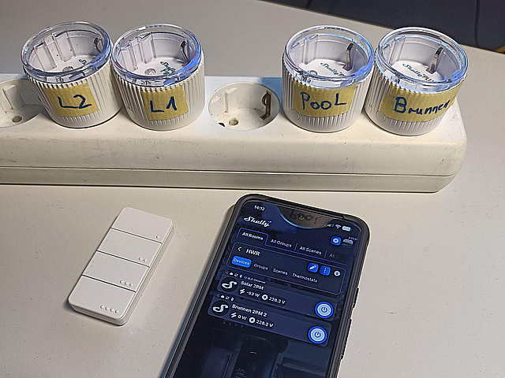

Maker Media GmbH

***

# Ein Knopf für alle(s)

Vier Tasten auf einer Shelly-Bluetooth-Fernbedienung schalten Licht, Pool- und Brunnenpumpe 
einfach und ohne Smarthome, sodass die ganze Familie ohne App zurechtkommt.

 

Den vollständigen Artikel gibt es in der Make 7/26.
